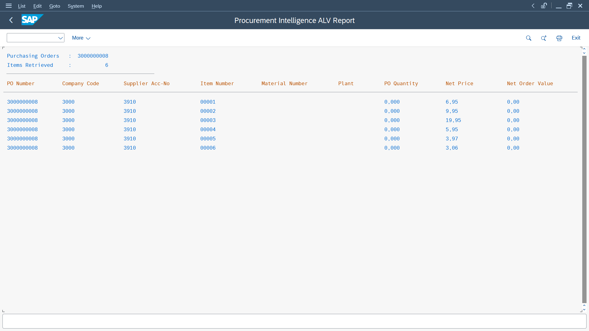
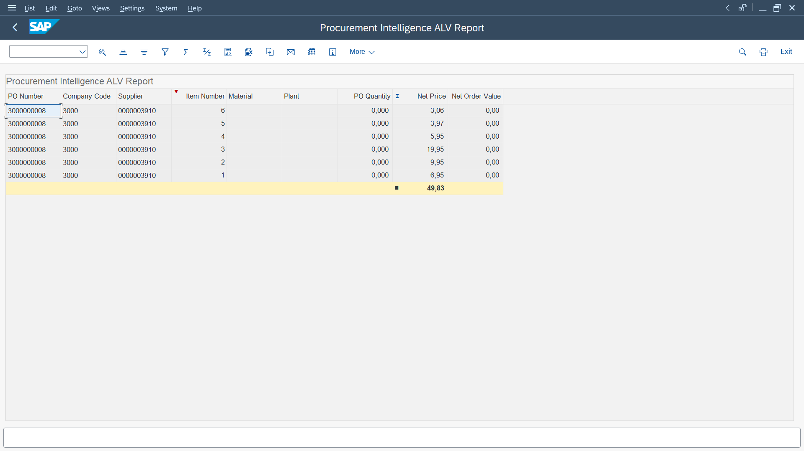
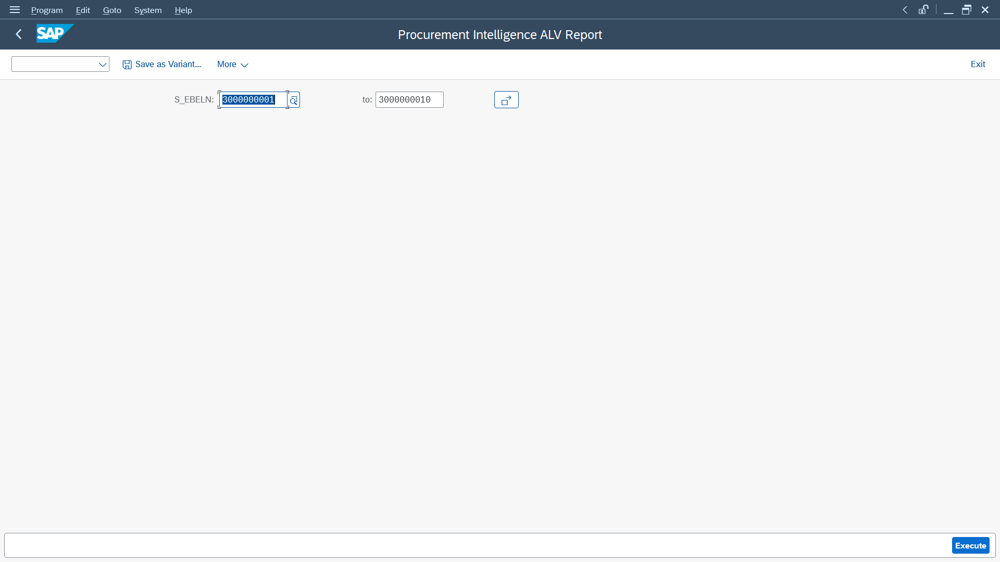
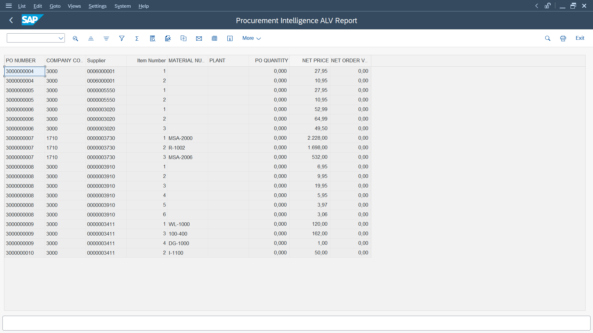
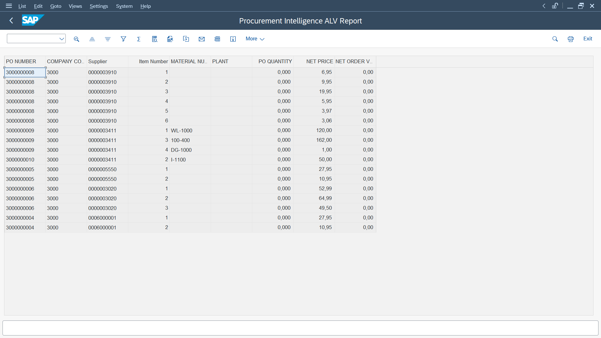
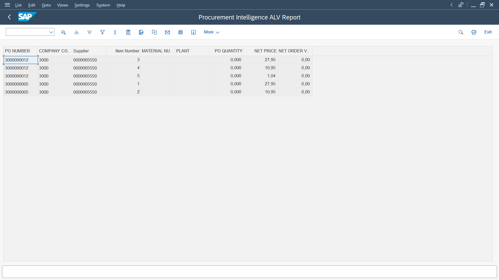
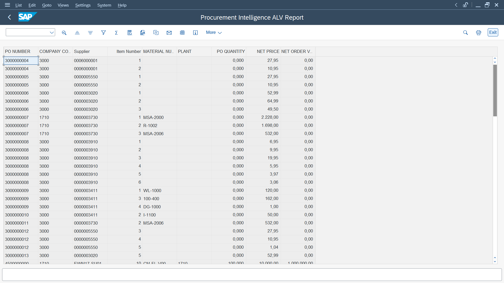
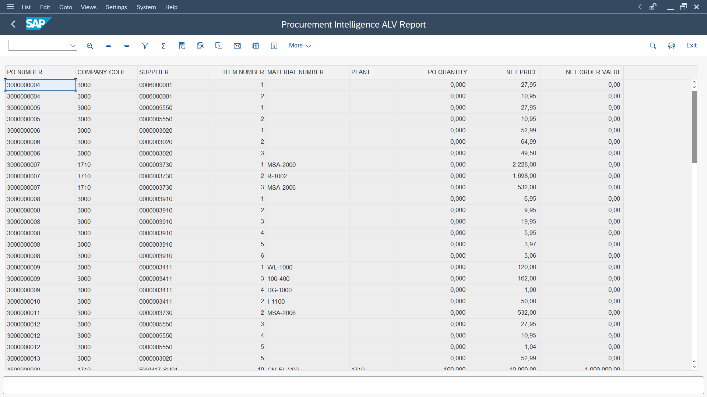
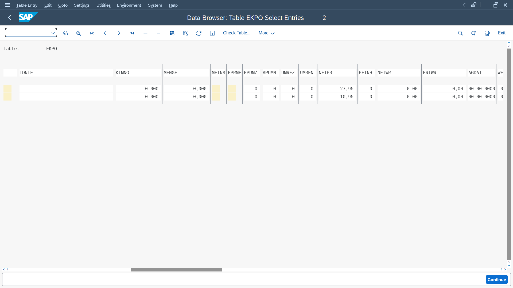

# SAP Procurement Intelligence & Vendor Performance Analytics

**An SAP ABAP on S/4HANA portfolio project focused on procurement reporting, vendor insights, and enterprise-grade development practices.**

## 🎯 Project Vision

Build a business-oriented procurement reporting solution that transforms SAP purchasing data into meaningful, actionable insights using ABAP and ALV reporting.

The objective is to move beyond isolated coding exercises and develop a solution that reflects how SAP technical consultants approach real business requirements.

## 💼 Business Problem

Procurement teams need clear visibility into purchasing activities, vendor transactions, purchase order values, and outstanding orders. Poor visibility and inefficient reporting can make it harder to identify exceptions and support timely decisions.

## 💡 Proposed Solution

Develop an interactive ALV reporting solution on SAP S/4HANA that enables users to:

- Analyse purchase order information.
- Filter and sort purchasing data using selection criteria.
- Review purchasing values and relevant order statuses.
- Identify outstanding orders and potential exceptions.
- Access structured, reliable reports for business analysis.

## 🏗️ Engineering Principles

- **Business-driven development:** Every feature addresses a defined business requirement.
- **Data accuracy:** Use appropriate SAP data sources and validate report results.
- **Performance optimization:** Write efficient ABAP and minimize unnecessary database access.
- **Maintainability:** Apply modularization, meaningful naming, and structured error handling.
- **Modernization:** Progress from ALV reporting to CDS views and RAP as the project evolves.
- **Quality assurance:** Validate functionality with documented test cases and expected results.

## 🛠️ Technology Stack

- SAP S/4HANA
- ABAP
- SAP GUI: SE38 / SE80
- Classical ALV Reporting (`REUSE_ALV_GRID_DISPLAY`)
- ABAP Dictionary
- Open SQL
- Git and GitHub

*Advanced technologies will be incorporated as implementation progresses and environment capabilities permit.*

## 📈 Expected Outcomes

- A functional, interactive procurement ALV report.
- Practical experience translating business requirements into ABAP solutions.
- Improved understanding of SAP data models, reporting, and performance.
- Documented technical decisions, test cases, and implementation screenshots.
- A portfolio project demonstrating SAP development skills and engineering discipline.

## 🗺️ Development Roadmap

1. Business requirements and technical design.
2. Data source analysis and report structure.
3. Classical ALV report implementation.
4. Flexible selection screens and procurement data filtering.
5. ALV presentation enhancement and database-level data validation.
6. Testing, debugging, and performance improvements.
7. Final documentation and interview preparation.
8. Future enhancements: Modern ABAP, CDS Views and RAP.

## 🚧 Project Status

**Current Phase:** Day 6 — Testing, Debugging & Performance Review

### Completed

- [x] Project vision and roadmap
- [x] Business Requirements Document (BRD)
- [x] Technical Design Document (TDD)
- [x] ABAP report with EKKO–EKPO data retrieval
- [x] INNER JOIN using Open SQL
- [x] Purchase order selection using `PARAMETERS`
- [x] Interactive ALV Grid using `REUSE_ALV_GRID_DISPLAY`
- [x] Custom ALV field catalog
- [x] Sorting and aggregation tested
- [x] Flexible purchase order selection using `SELECT-OPTIONS`
- [x] Multiple purchase order retrieval using SQL `IN`
- [x] Company code and supplier selection criteria
- [x] Combined filtering across multiple selection criteria
- [x] Optional selection criteria validated
- [x] ALV column widths configured using `OUTPUTLEN`
- [x] ALV column headings and presentation improved
- [x] Database validation using SE16N
- [x] Compared EKPO source values with ALV output
- [x] Confirmed that zero quantity and net order values originate in the source data

### In Progress

- [ ] Investigate the business context behind zero-valued source records
- [ ] Explore selection-table concepts (`SIGN`, `OPTION`, `LOW`, `HIGH`)
- [ ] Further improve ALV usability
- [ ] Expand report validation with additional test cases

### Upcoming

- [ ] Advanced ALV interactions
- [ ] Procurement exception analysis
- [ ] Performance review
- [ ] Further S/4HANA development concepts

## 📸 Project Screenshots

### Day 1: Basic ABAP Report

Retrieved purchase order data from SAP S/4HANA using an ABAP database query and displayed the results using `WRITE` statements.

### Day 2: Interactive ALV Grid

Implemented an interactive ALV Grid using `REUSE_ALV_GRID_DISPLAY`, with a custom field catalog and standard ALV toolbar functionality.

### Day 3: Flexible Purchase Order Selection

Enhanced the selection screen using `SELECT-OPTIONS`, allowing users to enter individual purchase orders or specify a range.

### Day 3: Multiple Purchase Order Retrieval

Successfully retrieved 20 purchase order items across a selected purchase order range using ABAP SQL with the `IN` operator.

### Day 4: Multiple Selection Criteria

Enhanced the selection screen with purchase order, company code, and supplier selection criteria to support flexible procurement reporting.

### Day 4: Purchase Order Range and Company Code Filtering

Validated combined filtering using a purchase order range and company code.

### Day 4: Company Code and Supplier Filtering

Verified that the report retrieves matching purchase order items using company code and supplier selection criteria.

### Day 4: Optional Selection Criteria

Tested the report with all selection fields empty and verified that purchase order data across available company codes could be retrieved.

### Day 5: ALV Presentation Enhancement

Improved the ALV report layout by configuring column display widths using the `OUTPUTLEN` property of the `SLIS_FIELDCAT_ALV` field catalog structure. Updated the presentation to make column headings and procurement data easier to read.

### Day 5: Database-Level Data Validation

Investigated zero values displayed in the purchase order quantity and net order value columns. Used SE16N to inspect the corresponding EKPO records and compared the database values with the ALV output.

Confirmed that the report accurately retrieves the source data, and that the zero values already exist in the database.

---

*This is an independent learning and portfolio project. Features are documented as they are implemented and tested.*

*The goal is not merely to write ABAP code, but to build a maintainable solution that connects SAP technology with real business needs.*